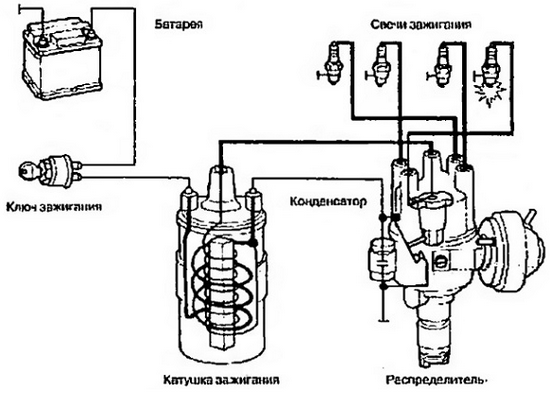

<h1>Система зажигания</h1>

Наверное, одна из самых главных систем бензиновых автомобилей - это система зажигания. Многие автолюбители представляют себе лишь свечи и катушки. По сути, так и есть. Но не совсем так. точнее это не полный список элементов.

Возьмем простейшую систему зажигания:

Вот тут мы как раз и видим те самые свечи (в верхнем правом углу рисунка). Присутствует и катушка зажигания (внизу посередине). Но на рисунке есть еще один компонент: распределитель. Упс! А это "кто такой"?

А это механический распределитель зажигания. Так! Не плюем в экран! дальше будет интереснее.

Чем занимается этот распределитель? Распределяет напряжение по свечам и, по сути, без него не будет высокого напряжения на выходе катушки. Зачем нужно распределять напряжение? Затем, что искрв должна зажечься в определенный момент времени. Пока юудем считать, что этот момент наступает, когда поршень в ВМТ (Верхняя Мертвая Точка).

Теперь ответ на вопрос: почему не будет искры? Для образования искры необходимо высокое напряжение. Откуда оно берется? Катушка зажигания представляет из себя обычный трансформатор. Только вот автомобиль использует ее больше как дроссель: подается питание на низковольтную обмотку катушки. За какое-то минимальное время катушка накапливает энергию, преобразуя ее в магнитную. Как только накапливать энергию уже некуда, катушка начинает просто греться. Как только мы перестанет питать катушку низковольтным током (разомкнем цепь низковольтной обмотки), это магнитное поле начнет изменяться, тем самым возбуждая вторичную высоковольную обмотку. Так как индуктивности способны отдавать энергию практически мгновенно, то нарастание напряжения будет ОЧЕНЬ быстрым. Можно сказать мгновенным. В этот момент в свече, подключенной к ВВ (высоковольтной) обмотке, происходит пробой зазора между электродами. Резко начинает расти сила тока - искра становится мощной и жирной. А причем же тут распределитель зажигания? В нем как раз и находится то устройство, которое замыкает и размыкает цепь первичной обмотки катушки. В тот момент, когда он разыкает цепь, бегунок уже замкнул ВВ выход катушки на определенный провод свечи. И именно там (в определенном циллиндре) проскакивает искра и воспламеняет смесь.
